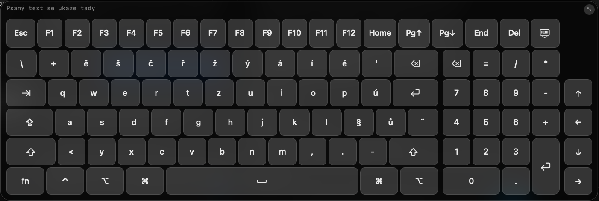

# TouchHelper
I use my Mac exclusively with verbatim PMT-14 touch. This app solves few problems I had to live before. It is written by Codex, but somebody may find it useful. 
TouchHelper is a small native macOS utility that provides touch-friendly window controls and an on-screen keyboard. Its floating panel stays near the Dock and controls the currently active window.


*TouchHelper's floating control panel on macOS.*

## Features

- Large close, minimize, and zoom buttons for the active window
- The standard macOS zoom menu when the green button is pressed and held
- A floating panel that stays available across Spaces and full-screen apps
- An on-screen ISO keyboard with a separate numeric keypad
- Key labels and output that follow the current macOS keyboard layout
- Sticky `Shift`, `Control`, `Option`, `Command`, and `fn` modifier keys
- Caps Lock, function keys, navigation keys, arrow keys, and forward delete
- A resizable keyboard whose size is remembered between launches
- Automatic launch-at-login registration

## Requirements

- macOS 13 Ventura or later
- Swift 6
- A full Xcode installation at `/Applications/Xcode.app`

TouchHelper is built with Swift Package Manager and has no third-party package dependencies.

## Build and run

From the repository root, run:

```zsh
chmod +x Scripts/build-app.sh
Scripts/build-app.sh
open TouchHelper.app
```

The build script creates a release build, packages it as `TouchHelper.app` in the repository root, and applies an ad-hoc code signature.

## Accessibility permission

TouchHelper needs Accessibility permission to control other applications' windows and send keyboard events. macOS requests permission when you first use a window control or the on-screen keyboard.

Enable the app under:

**System Settings > Privacy & Security > Accessibility**

## Usage

### Window controls

Use the red, yellow, and green buttons to close, minimize, or zoom the currently active window. Press and hold the green button to open the standard macOS zoom menu.

The panel is positioned to the left of a bottom Dock. If the Dock is placed on the side of the screen, the panel remains in the available area at the bottom left.

### On-screen keyboard



*TouchHelper's resizable on-screen keyboard.*

1. Focus a text field in the target application.
2. Select the keyboard icon in the TouchHelper panel.
3. Use the collapse button or select the keyboard icon again to hide the keyboard.

The keyboard follows the active macOS input source and updates automatically when the layout changes. Dead keys and composed characters behave like their physical-keyboard equivalents.

Modifier keys are sticky: select `Shift`, `Control`, `Option`, `Command`, or `fn`, then select another key to send the combination. Active modifiers are highlighted and released after the shortcut is sent. Caps Lock stays active until selected again.

The top row includes `Esc`, `F1`–`F12`, Home, End, Page Up, Page Down, and forward delete. Arrow keys are placed beside the numeric keypad and support standard shortcuts such as `Shift` + Arrow for selection and `Option` + Arrow for word navigation.

Resize the keyboard by dragging the handle in its top-right corner. TouchHelper saves the selected size and restores it the next time the keyboard opens.

## Launch at login

TouchHelper attempts to register itself as a login item when it starts. If macOS requires approval, the app opens the Login Items settings so you can allow it.
